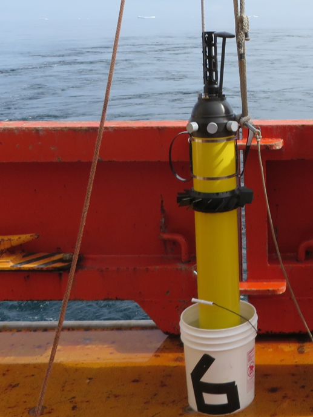

# Teledyne Apex Deployment Instructions

Christopher Gordon 
Fisheries and Oceans Canada 
[chris.gordon@dfo-mpo.gc.ca](mailto:chris.gordon@dfo-mpo.gc.ca)

## Introduction

There are 2 mains ways of activating Apex floats for deployment. The first is by simply deploying it - the float will pressure activate, perform a system test, and begin its mission automatically. The second is with a magnet swipe on deck. This will also initiate the float's system test, offering more control as any issues can be caught before the float is in the water. 

## Preparation

Remove the float from the crate and stand up, careful not to damage the sensors or antenna on the head of the float. If you are able, it can be helpful to sit the float in a bucket of seawater before deployment, especially if doing a pressure activated deployment. This will fill a reservoir in the bottom of the float allow it to sit vertically in the water and sink more quickly (thus pressure activate more quickly). 

**Remove plugs and covers from sensors**. This includes a 3-piece plug for Seabird CTDs, and optionally any caps on BGC sensors. RBR CTDs (red in colour) do not have any caps that need to be removed. 

Prepare the log sheet with any relevant info known before deployment (station number, deployer, ship, etc.). 

## Deployment

The most important part of deployment is that the float is lowered gently in the water! There is a while metal collar around the float with a hole for a slip line or a quick release knot. The float is just light enough that usually 1-2 people are able to hand deploy it, but the ship crane can be used as well. Deployment can vary depending on conditions and vessel, so always collaborate with the bridge and deck crew to ensure a safe and successful deployment. 

On a typical oceanographic vessel, ask the bridge to steam at 0.5-1kt, and plan to deploy off the rear quarter of the working deck. This helps ensure that the float gets clear of the ship and does not bump into it poitentially damaging sensors. If the ship has propulsion at the back of the ship, this cannot be used for risk of causing damage to the float and the ship itself.

Record position (lat, long), date, time, and any other relevant information on the log sheet. A picture of deployment is appreciated but not mandatory!

### Using the magnet swipe ("reset tool")

Slowly swipe the Reset tool against and across the housing beginning about five centimeters above the RESET label and ending in a semicircle about five centimeters below the RESET label.

After about 30 seconds, a beep will sound for about three seconds, and then the float will perform the self test which includes inflating the air compartment and filling the oil compartment of the bladder. The self test typically takes about 25 minutes to complete. If all of the checks performed by the self test pass, the beep will sound again for about three seconds, and files will be uploaded and downloaded over the Iridium satellite network.

With the files being sent over Iridium, the Argo Canada team may ask you to wait for confirmation/validation of the files before deployment. In that case, wait for go-ahead from the point of contact. 

*Warning: Once the float starts running a mission, do not swipe the reset tool again, as doing so may stop the mission.*

## Post-deployment

Please send all deployment info on the log sheet to [chris.gordon@dfo-mpo.gc.ca](mailto:chris.gordon@dfo-mpo.gc.ca). Thank you!